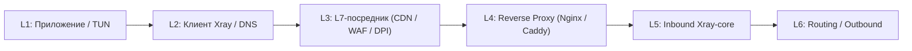
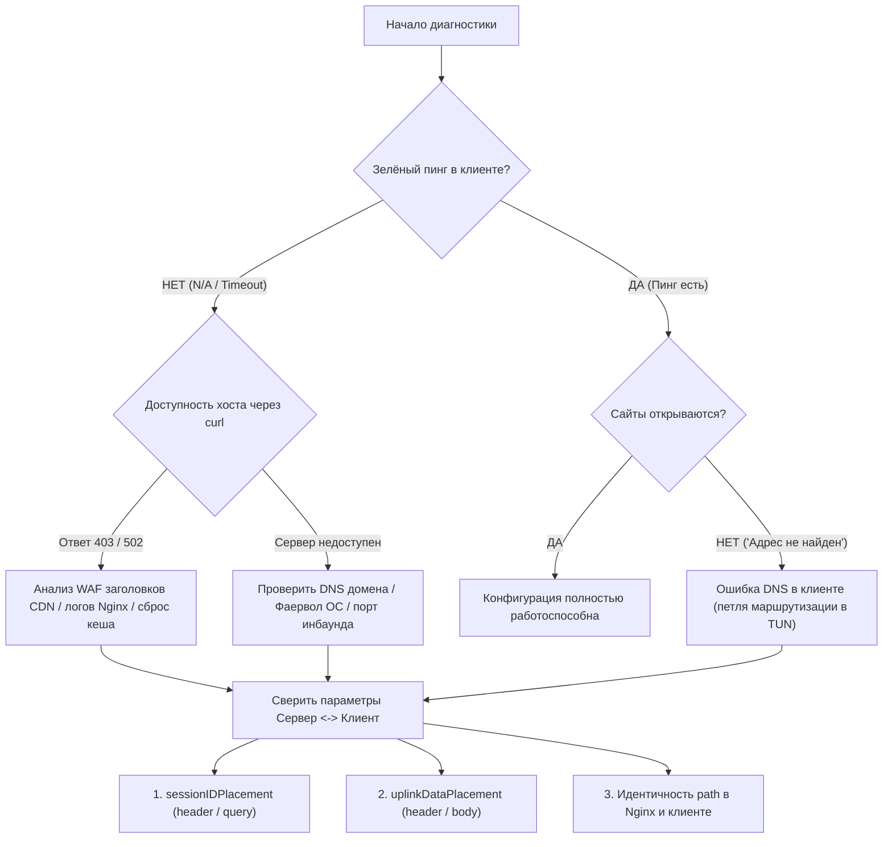

# Реверс-инжиниринг и диагностика подключений Xray

Данное руководство описывает системную методику обратного анализа сетевого взаимодействия Xray-клиента, промежуточных узлов (L7-прокси, CDN, WAF) и Xray-сервера. Оно предназначено для быстрой локализации причин сбоев, подбора валидной конфигурации транспортов и устранения блокировок.

---

## 1. Архитектурная модель коннекта (Data Flow & Failure Points)

Любое подключение Xray представляет собой цепочку из 6 дискретных слоёв. Сбой на любом из них даёт специфический сетевой симптом:



### Матрица симптомов по уровням:

| Уровень сбоя | Типичные симптомы | Что видно в логах / поведении |
| :--- | :--- | :--- |
| **L1/L2: DNS & TUN** | Пинг в клиенте зелёный, но сайты не открываются (`Адрес не найден`) | DNS query loop, блокировка резолвера в туннеле, перехват 53 порта |
| **L2: Client Core** | Ошибка парсинга конфига, мгновенный сброс TLS | Падение `LibXray`, строгая ошибка `verifyPeerCertByName`, mismatch ciphers |
| **L3: WAF / CDN** | Мгновенный `403 Forbidden`, `400 Bad Request`, сброс TCP FIN/RST | Запросы не доходят до хоста. Кастомные заголовки WAF, кэширование ошибок `403 HIT` |
| **L4: Reverse Proxy** | `502 Bad Gateway`, `413 Payload Too Large`, `400/404` | Ошибки в логах Nginx, буферизация потока, обрезка длинных заголовков |
| **L5: Inbound Core** | Подключение зависает, `unsupported placement`, падение инбаунда | Несовместимость типов данных в JSON, рассинхрон параметров сессии |
| **L6: Outbound** | Туннель поднимается, но трафик уходит в никуда | Ошибки `direct`/`freedom`, бан исходящего IP хоста, зацикливание маршрутов |

---

## 2. Методика синтетического зондирования (Active Probing)

Для реверс-инжиниринга скрытых ограничений между клиентом и сервером используется метод **дифференциального тестирования**:

### Шаг 1. Локальная проверка инбаунда (Zero-Ground Truth)
Проверка того, как сам Xray-core реагирует на входящие запросы на локальной петле:
```bash
# Сырой запрос к порту инбаунда
curl -iv http://127.0.0.1:<INBOUND_PORT>/<PATH>
```
* **Норма**: для WebSocket/XHTTP ответ `HTTP 400 Bad Request` — это корректная реакция ядра на запрос без протокольной сессии Xray.
* **Аномалия**: `Connection refused` (инбаунд не запущен / порт закрыт) или `500 Internal Error`.

### Шаг 2. Проверка связки Nginx -> Xray (Прямой обход)
Запрос выполняется напрямую к внешнему IP или прямому домену сервера, минуя CDN/WAF:
```bash
curl -iv -H "Host: <ORIGIN_DOMAIN>" https://<SERVER_IP>/<PATH>
```
* Если прямой запрос доходит до Nginx и отдает `400` от Xray — уровень L4/L5 полностью исправен. Любая проблема выше этого шага вызвана L3 (CDN/WAF).

### Шаг 3. Анализ пограничных ответов CDN/WAF
Запрос отправляется через публичный CDN-домен с эмуляцией заголовков клиента:
```bash
curl -iv -H "User-Agent: Happ/1.0" -H "Host: <CDN_DOMAIN>" https://<CDN_DOMAIN>/<PATH>
```
* **Анализ заголовков ответа**:
  * `Server`: выдаёт тип пограничного прокси (Nginx, Cloudflare, CDNvideo, etc.).
  * Заголовки безопасности: `x-reason-code`, `x-waf-status`, `cf-mitigated`.
  * Кеширование: `x-cache`, `x-cdn-edge-cache: HIT`. Если CDN закешировал ответ `403` или `502`, любые изменения на сервере не дадут эффекта до выполнения **Purge Cache**.

---

## 3. Каталог протокольных аномалий и паттернов несовместимости

При реверс-инжиниринге Xray-конфигураций проверяются следующие скрытые конфликты:

### 1. Семантика HTTP-методов и тела запроса (Payload Constraints)
* **Проблема**: Некоторые CDN/прокси разрешают только методы `GET, HEAD, OPTIONS` и **жестко сбрасывают GET-запросы с непустым телом (Body > 0)**.
* **Диагностика**: Отправить POST и GET с телом через curl:
  ```bash
  curl -X POST -d "test" https://<DOMAIN>/<PATH>
  curl -X GET -d "test" https://<DOMAIN>/<PATH>
  ```
* **Решение**:
  * Перевод транспорта в режим раздельных пакетов (`mode: "packet-up"`).
  * Принудительное указание метода: `"uplinkHTTPMethod": "GET"`.
  * Перенос аплинк-данных из тела в заголовки: `"uplinkDataPlacement": "header"`.

### 2. Скрытые ограничения размещения данных в Xray-core
* **Ловушка `uplinkDataPlacement`**:
  * В Xray-core для передачи данных аплинк поддерживаются **только** значения `"header"` и `"body"`.
  * Значение `"query"` разработчиками **не реализовано** (вызывает фатальную ошибку ядра: `unsupported uplink data placement`).
* **Где `query` разрешён**:
  * Только для метаданных сессии: `sessionIDPlacement: "query"` (параметр `?sid=...`) и `seqPlacement: "query"` (параметр `?chunk_id=...`).

### 3. Эвристика WAF: ложные срабатывания на заголовки и токены
* **Сигнатура SSRF / Header Injection**:
  * В режиме маскировки паддинга `queryInHeader` Xray может генерировать заголовок с полным URL:
    `X-Client-Version: https://domain.com/path?hash=...`
  * WAF пограничных серверов часто расценивают схему `https://` и слеши внутри пользовательского заголовка как инъекцию.
  * *Решение*: переключение в `"xPaddingPlacement": "header"` (передаёт только чистый токен без протокола и пути).
* **Сигнатура невалидного токена в Query-параметрах**:
  * По умолчанию Xray генерирует 36-значный UUID с дефисами для `sid` (формат: 8-4-4-4-12 шестнадцатеричных символов).
  * Медиа-CDN с защитой потоков расценивают параметры формата UUID как невалидный/просроченный Secure Token и отсекают запрос с кодом `403`.
  * *Решение*: сокращение длины и смена алфавита SID:
    ```json
    "sessionIDPlacement": "query",
    "sessionIDLength": "12",
    "sessionIDTable": "abcdefghijklmnopqrstuvwxyz0123456789"
    ```

### 4. Буферизация и переполнение заголовков в Reverse Proxy
* **Переполнение `large_client_header_buffers`**:
  * При передаче аплинк-данных через HTTP-заголовки (`uplinkDataPlacement: "header"`) размер одного запроса может превышать стандартный буфер Nginx (4 КБ / 8 КБ), вызывая ошибку `400 Bad Request` или `414 Request-URI Too Large`.
  * *Решение на Nginx*: `large_client_header_buffers 4 16k;` (или `32k`).
  * *Решение в Xray*: ограничение максимального размера чанка `"scMaxEachPostBytes": "200000"`.
* **Зависание стриминга (Buffering Stalling)**:
  * Если прокси пытается буферизовать тело запроса или ответа перед отправкой, двунаправленный поток (XHTTP stream / WebSocket / gRPC) замерзает.
  * *Решение*: отключение буферизации (`proxy_buffering off; proxy_request_buffering off;`).

### 5. Специфика клиентских ядер (LibXray vs IncyCore vs Vanilla Xray)
* **Поле `verifyPeerCertByName`**:
  * Значения вроде `"0"`, `"false"`, `""` в экспортированном JSON могут интерпретироваться разными ядрами по-разному.
  * В `LibXray` (Happ) это вызывает буквальную сверку SAN сертификата со строкой `"0"` -> фатальная ошибка TLS (`cert is invalid`).
  * *Правило*: фиктивные значения должны полностью удаляться из JSON перед импортом в клиент.

---

## 4. Диагностический чеклист: Пошаговый алгоритм локализации

При получении жалобы или неработающей конфигурации следовать строгому алгоритму:



---

## 5. Системные инварианты хоста (Linux Kernel Network Tuning)

Для транспортов с высокой частотой коротких TCP/HTTP соединений (например, чанкованный XHTTP через CDN):
* **Отслеживание соединений (conntrack)**:
  ```bash
  # Мониторинг заполнения conntrack-таблицы
  cat /proc/sys/net/netfilter/nf_conntrack_count
  cat /proc/sys/net/netfilter/nf_conntrack_max

  # Безопасное увеличение лимита для серверов с ограниченной RAM (1-2 ГБ)
  sysctl -w net.netfilter.nf_conntrack_max=131072
  ```
* **Лимиты дескрипторов файлов**:
  Убедиться, что процессы `nginx` и `xray` не упираются в системный лимит `nofile` (проверка через `prlimit -p <PID>`).

---

## 6. Симуляционный стенд iOS (NetworkExtension + LibXray Simulation Stand)

В `Xray-Probe` 0.6.0+ встроен изолированный стенд симуляции работы конфигураций в окружении iOS (Happ / Streisand / Shadowrocket / FoXray):
* **Архитектурный контур**:
  1. Universal Decoder (`SubscriptionDecoder`): парсинг Xray JSON, `subscription.raw`, URI `vless://`, `vmess://`, `trojan://`, `ss://`, base64 списков.
  2. Native Go Bridge (`libtun2socks.so`): L3 IPv4 framing, UDP SOCKS5 Associate для DNS (:53) и TCP SOCKS5 CONNECT (окно 65535, как в iOS NEPacketTunnelFlow).
  3. Apple Jetsam Watchdog: мониторинг RSS памяти ядра Xray (`/proc/<pid>/statm`) с порогом 50 МБ (стандартный лимит NetworkExtension), отслеживание пиков и опциональный hard-kill при превышении.
* **Запуск через CLI**:
  ```bash
  # Проверка конфигурации или подписки в стенде iOS
  node client.cjs ios-test --config /path/to/config.json --limit 50 --dns cp.cloudflare.com
  ```
* **Запуск через API**:
  `POST /ios/test` c JSON `{ "config": ..., "url": "https://www.gstatic.com/generate_204", "dnsHost": "cp.cloudflare.com", "jetsamLimitMb": 50 }`.

## 7. Модуль диагностики TikTok на iOS (TTNet / QUIC / Akamai 429 / SIM)

В `Xray-Probe` 0.6.1+ встроен специализированный модуль для тестирования и реверс-инжиниринга подключений TikTok на iPhone:
* **Диагностические фазы (`TikTokProbe`)**:
  1. **DNS**: разрешение API (`api16-normal-c-useast1a.tiktokv.com`) и CDN (`p16-sign-va.tiktokcdn.com`) через туннель.
  2. **TCP API Handshake (TTNet Cronet)**: отправка запроса с User-Agent официального клиента iOS, проверка HTTP статуса (выявление 429 Too Many Requests от Akamai WAF) и заголовка `alt-svc: h3`.
  3. **QUIC UDP:443 Blackhole Probe**: отправка синтетического QUIC Initial пакета на UDP 443; выявляет «тихий сброс» пакетов (пакеты уходят в черную дыру, заставляя плеер iOS зависать на 15-30 с перед переключением на TCP). При правильной настройке сервер Xray должен мгновенно отклонять UDP 443 (`QUIC_REJECTED_FAST`).
  4. **Video CDN Reachability**: проверка сквозного доступа к серверам раздачи видео (`p16-sign-va.tiktokcdn.com`).
  5. **SIM Card Inspector**: детекция российских SIM-карт (MCC 250 / RU), из-за которых официальный TikTok на iOS включает региональную блокировку ленты.
* **Запуск через CLI**:
  ```bash
  node client.cjs tiktok-test [config.json|index|url]
  ```
* **Запуск через API**:
  `POST /tiktok/test` с JSON `{ "input": "0", "strict": true, "timeoutMs": 15000 }`.

## 8. Пул подписок и управление узлами (Subscription Pool)

В `Xray-Probe` 0.7.0+ встроен пул подписок для персистентного хранения и быстрого переключения рабочих конфигураций и узлов:
* **Функционал**:
  1. Персистентное хранилище `subscription_pool.json` в приватном каталоге приложения.
  2. Поддержка URL-ссылок (с User-Agent `Happ/1.0`, извлечением лимитов трафика из `Subscription-Userinfo` и названий из `Profile-Title`), сырых конфигураций и списков ссылок.
  3. Глобальный селектор активного узла (`active`), который автоматически подставляется во все тесты (`ios-test`, `tiktok-test`), если узел не указан явно.
* **Управление через CLI**:
  ```bash
  # Список всех подписок и текущий активный узел
  node client.cjs pool list
  node client.cjs pool active

  # Добавление подписки по URL или из файла
  node client.cjs pool add https://sub.example.com/api/v1/client/subscribe "Caelix Frankfurt"
  node client.cjs pool add /sdcard/Download/config.json "Local Config"

  # Выбор активного узла (subId и индекс ноды)
  node client.cjs pool select <sub_id> 0

  # Принудительное обновление подписки по URL
  node client.cjs pool update <sub_id>

  # Удаление подписки
  node client.cjs pool delete <sub_id>

  # Запуск тестов со ссылкой на активный узел по умолчанию
  node client.cjs ios-test
  node client.cjs tiktok-test
  ```
* **Управление через API**:
  - `GET /subscriptions` — список сохраненных подписок и статус активного узла.
  - `GET /subscriptions/active` — детальная информация о выбранном тестовом узле.
  - `POST /subscriptions/add` — тело `{ "url": "...", "name": "..." }` или `{ "content": "...", "name": "..." }`.
  - `POST /subscriptions/select` — тело `{ "id": "...", "nodeIndex": 0 }`.
  - `POST /subscriptions/update` — тело `{ "id": "..." }`.
  - `POST /subscriptions/delete` — тело `{ "id": "..." }`.
